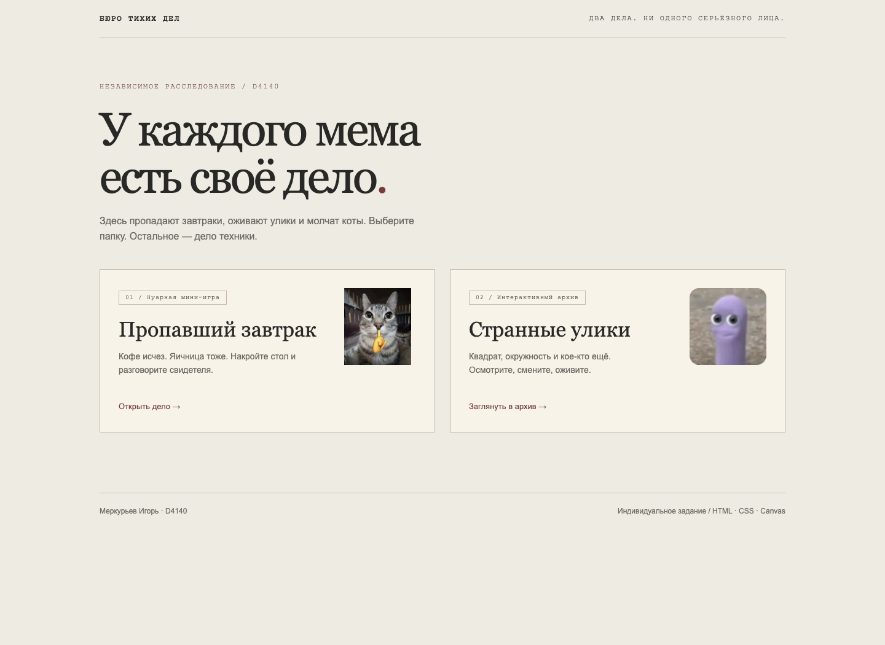
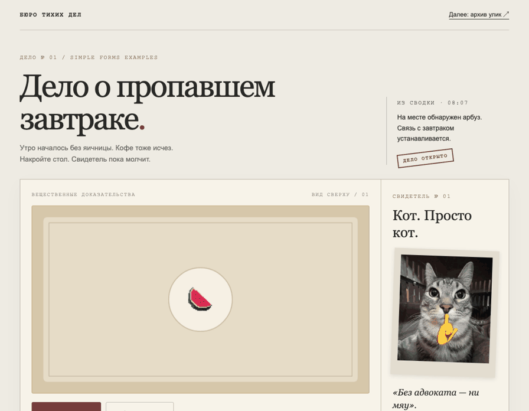
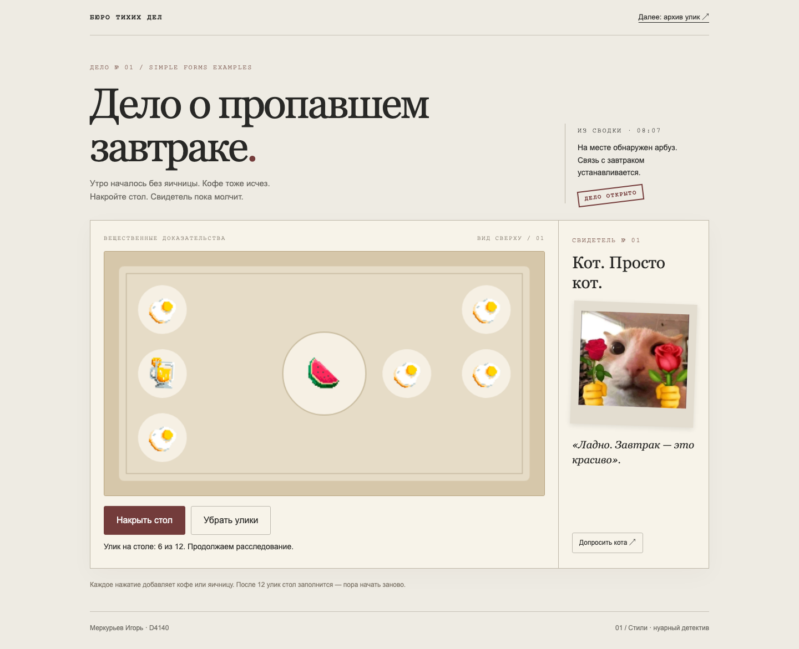
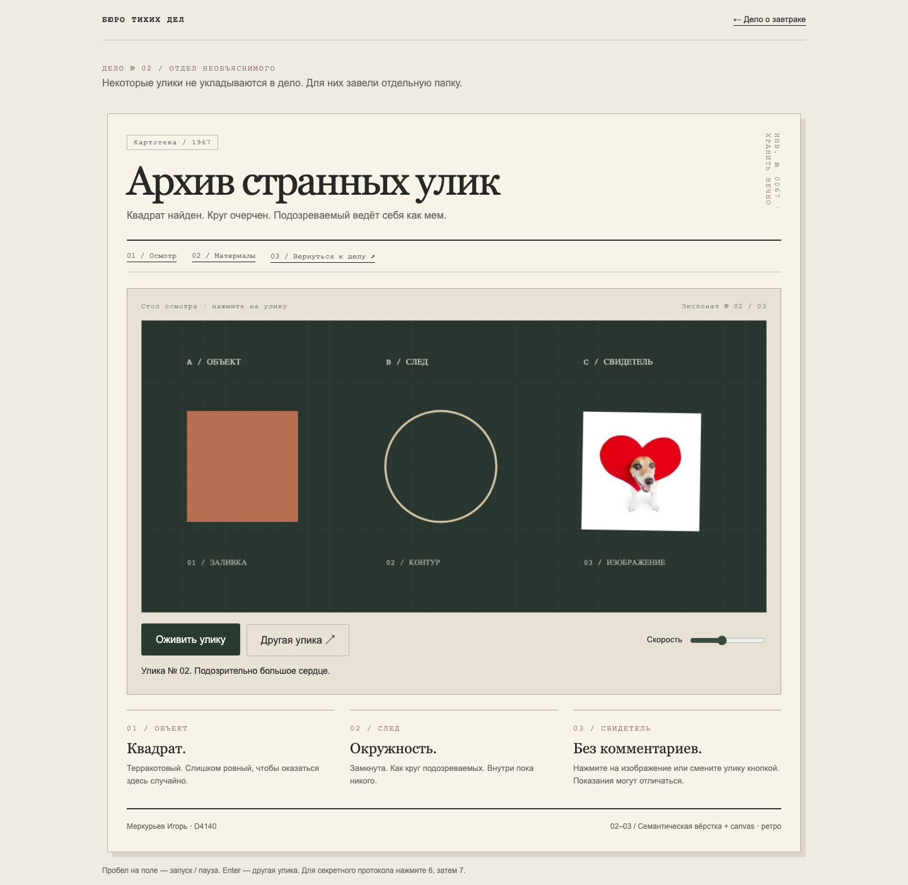
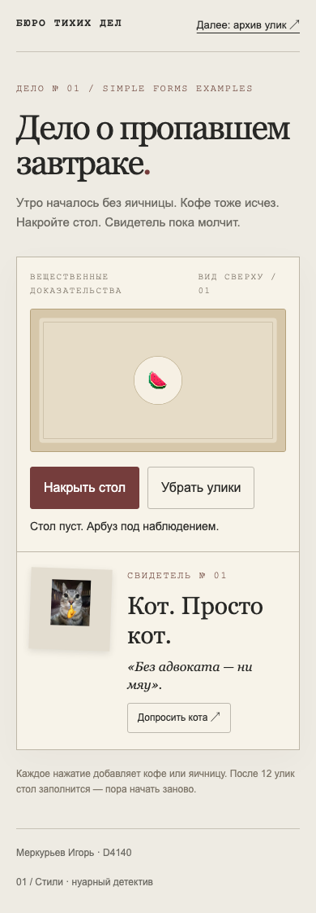
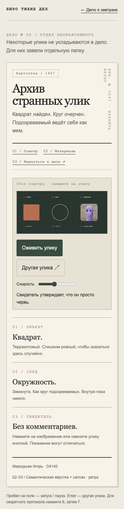

# Бюро тихих дел

**Меркурьев Игорь · D4140**  
Индивидуальное задание по HTML, CSS и Canvas. Два небольших расследования в одной визуальной истории: сдержанный нуар, ретроархив и мемы из Telegram.

**[Открыть демо](https://rogirem.github.io/the-breakfast-case/)** · [Завтрак](https://rogirem.github.io/the-breakfast-case/breakfast/) · [Архив](https://rogirem.github.io/the-breakfast-case/archive/)



## Как это работает



### Дело № 01 — пропавший завтрак

Нуарное оформление исходной мини-игры **Simple Forms Examples**. На столе остался арбуз. Кнопка «Накрыть стол» добавляет случайную яичницу или напиток. «Убрать улики» очищает стол, сохраняя арбуз.

- До 12 предметов на отдельных местах: изображения не перекрывают друг друга.
- Кот меняет реакцию по мере заполнения стола.
- «Допросить кота» открывает секретный протокол № 67.
- Бумажный фон, бордовый акцент, шрифты с засечками и моноширинные пометки.



### Дело № 02 — архив странных улик

Вёрстка по схеме из задания: внешний `div`, `header` с `h1`, `nav` со ссылками, `main` с классом `main` и `canvas`, `footer` с ФИО. Дополнительные материалы оформлены через `section` и `article`.

На canvas нарисованы три объекта: залитый терракотовый квадрат, контур окружности и локальное изображение мема.

- «Оживить улику» запускает плавное покачивание мема; повторное нажатие ставит на паузу.
- Ползунок регулирует скорость.
- «Другая улика» или нажатие на мем переключает три изображения.
- Когда canvas в фокусе: **Пробел** — запуск / пауза, **Enter** — следующая улика.
- Последовательность **6**, **7** открывает секретную заметку; повторная последовательность закрывает её.
- Анимация не запускается автоматически и останавливается при скрытии вкладки.



<details>
<summary>Посмотреть мобильные версии</summary>

| Мини-игра | Архив |
| --- | --- |
|  |  |

</details>

## Соответствие заданию

| Часть | Реализация | Файлы |
| --- | --- | --- |
| Стили, 5 баллов | Выбран нуарный детектив; изменены цвета, шрифты, размеры текста, оформление кнопок; добавлены изображения | `breakfast/` |
| Разметка, 5 баллов | Вложенная структура по схеме, семантические теги, `margin`, `padding`, `border`; выбран ретростиль | `archive/index.html`, `archive/css/style.css` |
| Canvas, 6 баллов | `fillRect` для квадрата, `arc` + `stroke` для окружности, `drawImage` для изображения | `archive/js/script.js` |
| Необязательный бонус | Анимация через `requestAnimationFrame`, запуск / пауза, регулировка скорости | `archive/js/script.js` |

## Запуск

Без установки зависимостей: скачайте репозиторий, распакуйте и откройте `index.html` в современном браузере. Можно отдельно открыть `breakfast/index.html` или `archive/index.html`. Все шрифты системные, изображения локальные, приложение работает без интернета.

Для локального HTTP-сервера:

```sh
git clone https://github.com/rogirem/the-breakfast-case.git
cd the-breakfast-case
python3 -m http.server 8000
```

Затем откройте [localhost:8000](http://localhost:8000).

## Архивы для сдачи

1. [Часть 1 — работа со стилями](submission/01-styles-merkurev-D4140.zip).
2. [Части 2–3 — вёрстка и canvas](submission/02-layout-canvas-merkurev-D4140.zip).

В каждом архиве есть `index.html`, папки `css`, `js`, `images` и краткая инструкция. Сама работа открывается офлайн; ссылки на другую часть в этих отдельных копиях ведут к онлайн-демо.

## Структура проекта

```text
index.html             Общий вход
breakfast/             Часть 1: стилизация мини-игры
  index.html
  css/style.css
  js/script.js
  images/
archive/               Части 2–3: семантика и canvas
  index.html
  css/style.css
  js/script.js
  images/
docs/                  Реальные скриншоты и GIF-демонстрация
submission/            Два архива для сдачи
```

Обычные HTML, CSS и JavaScript, без фреймворков, сборщика, внешних шрифтов и сетевых запросов приложения. Публикация — GitHub Pages из ветки `main`.

## Проверка

Проверено в Chromium: загрузка страниц и ресурсов, добавление 12 предметов и ограничение, сброс стола, реакции кота, оба секрета, смена изображений, запуск / пауза анимации и управление клавиатурой. На ширине 390 px нет горизонтального переполнения. Отдельно проверен запуск мини-игры через `file://`. Скриншоты и GIF получены из работающей версии.

## Основа и изображения

- Часть 1 сделана на основе предоставленного учебного шаблона **Simple Forms Examples**. Сохранены механика стола и исходные изображения `watermelon.png`, `eggs.png`, `drink.png`; оформление и логика взаимодействий переработаны.
- Часть 2 начата с учебного шаблона **web_template2026**.
- Мемы взяты из предоставленных автором работы Telegram-стикеров в формате WebP. Названия локальных файлов приведены к латинице. Права на исходные изображения принадлежат их авторам; отдельная лицензия на них не заявляется.
